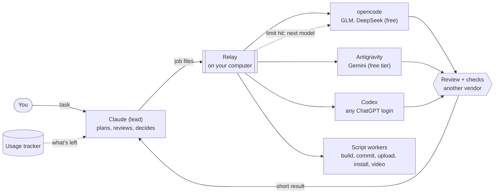

# Hivemind: one lead AI, a team of models

_Last updated: 2026-11-05_

Claude leads: it plans, reviews and decides. Free and low-cost models do most of the building: GLM and
DeepSeek through opencode, Gemini through Antigravity, Codex with any ChatGPT login. Scripts do the chores
(builds, commits, uploads, renders). Your Claude quota goes to thinking, not typing.
Runs on Windows, macOS and Linux.

**Start here:** Windows: [windows/README.md](windows/README.md). Mac or Linux: [mac-linux/README.md](mac-linux/README.md).
Every file and what to use when: [GUIDE.md](GUIDE.md).

## How it works

1. You give Claude a task in a chat (Claude desktop app; on Linux, Claude Code).
2. Claude splits it into small jobs and writes each as a file for the **relay**, a small script on your computer.
3. The relay runs each job with the right worker. When a model hits a limit, it moves to the next one by itself.
4. A model from a different company reviews the work; build, security and release checks run by name.
5. Claude reads a short result, not the whole log, and decides the next step.

**Remember:** the relay must be running, or Claude ends up doing everything itself and burns its own quota.
Open `Start Hivemind` before you work (Claude asks you if it's off).

## What you need
| Need | Windows | Mac | Linux |
|---|---|---|---|
| System | Windows 10/11 (installs WSL + Ubuntu) | macOS 13+ (installs Homebrew) | Ubuntu/Debian easiest; others work |
| Disk / memory | about 15 GB free, 8 GB RAM | about 10 GB free, 8 GB RAM | about 10 GB free, 8 GB RAM |
| The lead | Claude desktop app, Claude Pro or Max | Claude desktop app, Claude Pro or Max | Claude Code (no desktop app), Claude Pro or Max |
| Free workers | Google account (Antigravity), free opencode.ai account | same | same |
| Optional | ChatGPT login (Codex), OpenRouter key, NVIDIA GPU for local video | same; Apple Silicon for video | same |
| Git | Git for Windows | comes with Xcode tools | your package manager |

## How much usage you get (rough guide)
Providers rarely publish token numbers and change limits often. These are the published or widely reported
limits as of November 2026; `Usage` (shortcut 19, or the live window 20) shows your real numbers.

| Provider | Plan | Limit | In practice |
|---|---|---|---|
| Claude | Pro, $20/month | A 5-hour window plus a weekly cap; Anthropic's guidance is about 45 messages per 5 hours, shared by chats and Claude Code | Enough to lead: plans, reviews, small fixes. Max plans give 5x or 20x |
| opencode Zen free models (GLM, DeepSeek) | free | Not published; a shared rate limit that pushes back after several long jobs | The main builders. When one is busy, the relay moves to the next |
| Antigravity (Gemini) | free tier | A weekly agent quota; size not published (it has gone down over time) | Reviews, reading, second opinions |
| NVIDIA build (build.nvidia.com), optional | free key | Not published; about 40 requests a minute per account is reported, shared by all its models, no daily cap | Backup GLM and DeepSeek when Zen is busy, plus MiniMax, Nemotron, Mistral, Laguna, Step 5 for reviews and reading. Not for client or NDA work |
| OpenRouter free models | free | 20 requests a minute and 50 a day (1,000 a day once you have ever bought 10 USD of credits) | Extra helpers through PAL |
| Codex | any ChatGPT login | Depends on the ChatGPT plan; small on free | Joins the chains whenever it has quota |
| Local tools (ComfyUI, ACE-Step, Chatterbox) | free | Your own GPU | Images, clips, music, voice |

Rough total: no one can promise a token count for free tiers. A fair expectation is that the free workers carry
most of the coding each day, with Claude's quota spent on planning and review, so the same Pro plan goes several
times further than Claude alone. Your own numbers after a week of use (`Usage`) are the best guide.

## Folders
```
hivemind/
  README.md  GUIDE.md  LICENSE  CONTRIBUTING.md
  windows/       Windows: setup steps 0-9, Start Hivemind, Sync, shortcuts/
  mac-linux/     Mac and Linux: the same, as .command files
  templates/     the lead's rules (ROUTING.md) and project templates
  skills/        skills for Claude and the workers (index.yaml says what each is for)
  stacks/        playbooks per engine (web, Unity, video)
  gates/         build, security, release and review checks
  config/        models, fallback chains, limits
  rules/         rules every worker loads
  scripts/       what the launchers run (shared by all systems)
  studio/        local image, video and voice workflows
  relay/ logs/ secrets/ tools/    made on your computer; never uploaded
```
Projects go next to the hivemind folder (`Work/My Game`), never inside it.

## How the team works
1. **Plan:** Claude Opus writes PLAN.md and TASKS.md, one row per unit with a task class. You approve.
2. **Build:** Claude sends each unit to the right worker through the relay (opencode GLM / DeepSeek, Antigravity).
3. **Review:** another vendor reviews the work (Gemini reviews GLM's and DeepSeek's work; Claude checks the result).
4. **Gates:** build, security and release checks, run by name (`gates\`).
5. **Commit:** a `git-commit` job after review and gates pass. Workers never commit.
6. **Out of Claude quota:** drag the project onto `2 Continue Handoff - opencode` (in `windows\shortcuts` or `mac-linux/shortcuts`).

Who does what, and how to save tokens: `templates\ROUTING.md`.

## What is in each folder
| Folder | What |
|---|---|
| `stacks\` | Which engine to use (README.md) and a playbook per stack: setup, SDKs, dev loop, QA, builds (`web.md`, `unity.md`) |
| `templates\` | ROUTING.md (the lead's rules) and the project files CLAUDE.md, AGENTS.md, PLAN.md, TASKS.md |
| `rules\AGENTS-floor.md` | Rules every worker loads. Installed into opencode, Claude Code and Codex by `scripts\install-rules.sh` (runs on setup and on every Sync - Pull) |
| `gates\` | The build, security and release checks, and the review checklist |
| `skills\` | Local copies of your skills, with `index.yaml` (what each one is for, who may see it). Worker skills install into Codex and opencode automatically. See `skills\README.md` |
| `templates\android.env` | App facts for Android builds (name, bundle id, icon, version). Copied into each project |
| `secrets\android\` | `signing.env` (keystore, alias, password, bundle start) and the keystore that signs every app. Asked for on the first release build. Never goes to GitHub: back both up yourself. Example: `templates\signing.env.example` |
| `config\models.env` | Which model each worker uses, with the date it was decided. Edit here when a model is renamed |
| `relay\` | Job inbox and results |
| `secrets\keys.env` | Your keys. Never goes to GitHub |

## The relay: how jobs reach the models
Claude writes a job file to `relay\inbox\<id>.job`; the relay (started by `Start Hivemind`) runs it with the
worker the job names and puts the results in `relay\outbox\`. It is not Codex-only: it runs every worker below.
```
worker: opencode         (opencode, agy, review, gate, graph, git-commit, android; codex with a ChatGPT login, deepseek with an API key)
dir: /mnt/d/Work/My Game (Windows: WSL form. Mac/Linux: the normal path, /Users/me/Work/My Game)
model: free              (opencode: free = GLM, free2 = DeepSeek. agy: hard = Gemini Pro)
gate: build              (gate only: build, security, release)
fallback: none           (optional: turn off automatic fallback, or give your own chain)
---
<handoff: Task / Scope / Start from / Done when>
```
- **Automatic fallback:** if a model hits a limit or quota, isn't logged in, or isn't installed, the relay
  tries the next one by itself (for example GLM > DeepSeek > Gemini). Real errors are reported, not retried.
  Chains live in `config\models.env`.
- **Who picks the worker:** Claude, using `templates\ROUTING.md`. The relay only switches on failures.
- **Results:** `.done` (exit code) > `.last` (short answer + "worker used", read this first) > `.git`
  (status, diff stat) > `.diff` > `.out` (full log, only on failure).
- **Limits:** only folders inside the work folder, 45 min per job, up to 2 jobs at once, never two in the same folder.

## Free models (opencode)
Step 3 asks for your free opencode.ai key and gives it to opencode (OpenCode Zen); it is kept as OPENCODE_API_KEY in `secrets\keys.env`. The two free models are already set in
`config\models.env`: GLM-5.3-Flash (main builder) and DeepSeek V4.1 Flash (second builder, mechanical work).
Both keep no data and don't train on it. Free periods end: if `5 Check Everything.bat` shows one failing, run
`opencode models opencode` in Ubuntu (Mac/Linux: a terminal), pick a new id ending in `-free`, and paste it into `config\models.env`.
Avoid the Big Pickle, Flint, MiMo and Nemotron free models on OpenCode Zen for real work: they keep or train on data
(Nemotron through NVIDIA build, `nv2`, is a separate endpoint: own code only, see ROUTING section 8).
Optional extra: a free key from build.nvidia.com (`4 Add API Keys`, NVIDIA_API_KEY) adds MiniMax and Nemotron as
`model: nv` / `nv2`; they join the fallback chains and the review engines. Who gets which job and how the relay
switches: `templates/routing/models.md`.
Codex is used whenever it's logged in (any ChatGPT plan). Later: GitHub Copilot or a Google AI Studio key
fill the `copilot` / `gemini` lines. Don't log ChatGPT or Claude into opencode itself.

## Rules worth keeping
- Your Claude subscription login is only used in Claude Code and the Claude app. Never paste it into other tools.
- Client or NDA work: Claude and Antigravity only, unless you OK the zero-retention GLM/DeepSeek free models. Never OpenRouter free models or NVIDIA build.
- Never paste API keys into chat. Use `4 Add API Keys.bat`.
- Start a new chat per task: long chats cost far more tokens.

## Troubleshooting
| Problem | Fix |
|---|---|
| A command "not found" right after setup | Close all Ubuntu windows, run `5 Check Everything.bat` again |
| Claude Code in Ubuntu shows the Windows version | Run `2 Install AI Tools.bat` again, then restart the PC |
| A job hangs | The relay stops it after 45 min; restart the relay if needed |
| A free model stops working | Its free period ended: `opencode models opencode`, pick a new `-free` id, update `config\models.env` |
| PAL "failed to connect" | `windows\shortcuts\7 Fix PAL.bat` |
| Gemini CLI login refused | Expected: Google retired it. The kit uses Antigravity instead |
| opencode key won't paste in `3 Log In` | Right-click pastes in the Windows console (Ctrl+V may not). Nothing shows while pasting; after Enter it shows the length saved. Or put it in OPENCODE_API_KEY with `4 Add API Keys` |
| `3 Log In` keeps the old account | It never logs out. Log out first (Claude Code: `/logout` in `claude`), then log in. All tools: GUIDE.md, workflow H |
| Login link won't open | Ubuntu can't open your browser: copy the link manually |
| Codex ignores part of a project's AGENTS.md | Codex stops reading project AGENTS.md files past 32 KiB in total, without a warning. Shorten them |
| Codex shows the same skill twice | Codex reads both `~/.codex/skills` and `~/.agents/skills`. Keep a skill in one of them only |
| Codex job can't install packages | Its sandbox has no network by default. Install packages yourself, or ask Claude to |
| deepseek job says no key | Add DEEPSEEK_API_KEY with `4 Add API Keys.bat` |
| A job waits in the inbox | Another job is running in the same folder, or 2 jobs are already running. It starts on its own |
| Anything else | Ask Claude to read `logs\` and `relay\outbox\` |

## License and contributing
Free for personal and other noncommercial use under the PolyForm Noncommercial License 1.0.0 (see `LICENSE`).
Selling it, or using it in a paid product or service, needs permission. Want to help? Fork it and open a pull
request: see [CONTRIBUTING.md](CONTRIBUTING.md).
